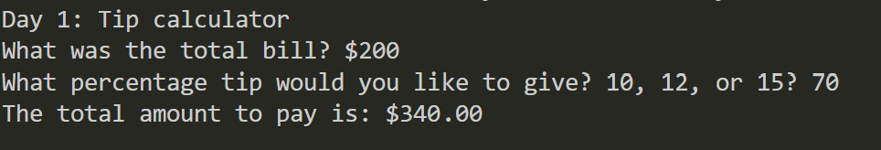

# Day 001: Tip calculator

## What it does

It calculates tip when entered a bill amoutn and tip percentage

## How to run

```bash
python main.py
```

## What I learned

- How to keep the decimal values intact 

## Screenshot / demo

_Add a screenshot or GIF here if the project is visual._

